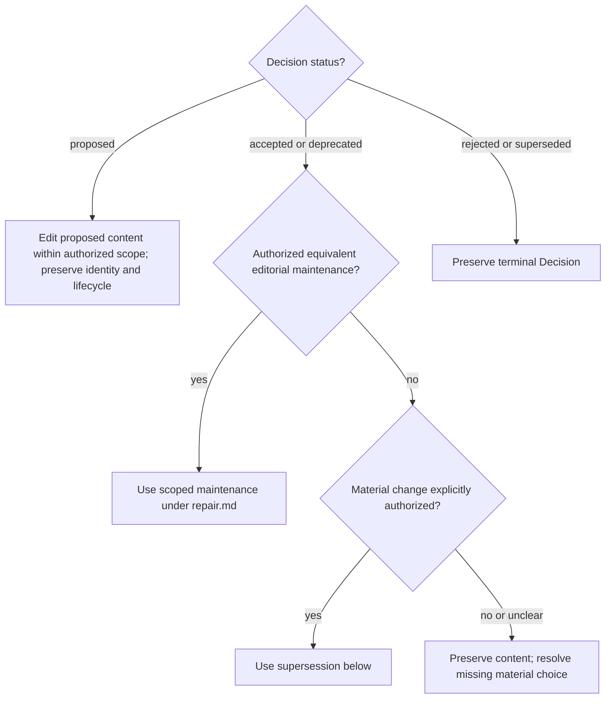

# Decisions

Use [progress.md](progress.md) for safe edits and validation and the entrypoint's
ID-allocation rule. Obtain the next ID and filename pattern with
`select_context.py --root "<project-root>" --next-id decision --format json`.
Apply [agent instruction design](instruction-design.md) when writing Decision
text. This reference owns its schema, binding sections and lifecycle.
For example, store ADR-0074 in `docs/decisions/0074-subject.md`. Use a lowercase slash-separated domain label
for `scope`, such as `product/import-pricing`. A new proposal follows this template:

```text
---
format_version: 1
id: ADR-0074
status: proposed
created: 2026-09-25
scope: project/concern
---

# Concrete choice

## Decision

Binding sections: complete

Recommended result or explicit human choice, with necessary reasons.

## Problem

Background situation.

## Drivers

- Nonbinding background consideration.

## Considered alternatives

- Nonbinding alternative.

## Consequences

Benefits, costs and limits introduced by this choice.

## Confirmation

Checks that would verify the choice, not an assertion they already passed.

## Revisit when

Concrete reconsideration trigger.
```

Fenced code examples are literal content, including lines starting with `#`.
Only headings outside backtick or tilde fences define the title and sections.

In new Decisions, put each binding condition, exception, authority limit and
reason needed for the choice, implementation, verification or revisit once in
Decision, Consequences, Confirmation or Revisit when. Problem, Drivers and Considered alternatives contain
only background, without discussion history or unnecessary rationale.
New Decisions use the owning Plan's language, or the task
request's language without an owning Plan. Preserve existing language unless
explicitly changed.

Keep all seven template headings exactly once; use `[]` for an empty background section.
The first non-blank content line under Decision is exactly
`Binding sections: complete` only when this self-contained binding contract holds.
Workflow may then deliver the four binding sections unchanged, with frontmatter
and title, instead of background. Unmarked Decisions remain complete. A misplaced
mark, code example or ambiguous section structure permits no projection. If an edit
adds binding content to a background section, remove the mark or move that content
to its binding owner. A mark does not change lifecycle, authority or format version.

## Links and transitions

Record links to Decisions in each affected Work Item's Decisions field,
following the entrypoint's linking policy and progress.md's edit permissions.
A proposal blocks only dependent work; its concrete effect
may be recorded in Instructions. Changing proposal status does not remove links.
Create a new Decision as proposed unless explicit human direction already
authorizes its immediate acceptance. That direction needs no repeated question.

Apply only explicitly authorized transitions:

| From | To |
| --- | --- |
| proposed | accepted or rejected |
| accepted | deprecated or superseded |
| deprecated | superseded |

During explicit maintenance under repair.md, that request authorizes these transitions:

| Finding | Action |
| --- | --- |
| A temporary Decision's end or fulfilment is proved; no binding condition remains. | Deprecate it; no empty replacement is needed. |
| Equivalent duplicate; every binding effect remains with its owning Decision. | Deprecate the duplicate and redirect its links to the owner. |
| A binding condition remains or its end is uncertain. | Keep the conditions and status. |

Age, a temporary title or cancellation alone proves no end. Preserve independent
conditions and unknowns.

Acceptance adds `accepted: YYYY-MM-DD` between created and scope. Deprecation
retains it. Proposed and rejected Decisions omit the accepted date. Rejected
and superseded Decisions are terminal.
Use actual dates no earlier than creation. For content changes, use this flow
with the legal status pairs above and existing authority. Ask only for a missing
material choice before dependent work.



Explicit maintenance under [repair.md](repair.md#maintenance-clean-up-existing-plans)
permits equivalent shortening, relocation into binding sections and adding the
binding mark in accepted or deprecated Decisions without supersession. Preserve
identity, choice, binding conditions, evidence status, authority and necessary
reasons; follow the transitions above. Proposal deletion requires checking that
no Work Item or Decision links to it, plus the deletion safeguard below.

Supersession preserves both records:

1. Create the accepted replacement with `supersedes: ADR-0001` after scope.
2. Set old status superseded and reciprocal `superseded_by: ADR-0002` after any supersedes.
3. Replace links in affected todo items. For started items, append the accepted
   replacement, retain the older link as history and explain the change, except
   when scoped cleanup below removes an irrelevant link.
4. Validate the coherent transition through progress.md.

Terminal historical links alone do not block replacement. Rejection in favor
of another proposal is not supersession.

## Scoped Decision cleanup

This is an exception to ordinary retention of supersession records, available
only within targeted new-Plan maintenance or expressly requested maintenance
under repair.md. Remove a temporary Decision only when its end or fulfilment
is proved and no binding condition remains. Remove a superseded Decision only
when its current binding effects remain readable with their current owner.
Age, status, filename or cancellation alone is insufficient.

Check incoming references before removal. Preserve current constraints even
when unlinked, other active Plans' dependencies and required historical facts.
Remove a Work Item link only when it governs nothing under the entrypoint's
linking policy. Clean obsolete links and reciprocal supersession links in the
same coherent update; leave no missing reference or invalid lifecycle. Preserve
existing batch metadata; keep a record when its removal would break that
integrity. Keep uncertain meaning or relevance instead of assuming expiry.

Delete a file only after verifying its current contents are committed, or
with explicit user approval of that deletion. A tracked path or some older
committed version does not suffice. Otherwise ask before deleting. Add no
archive, replacement report or state registry. Validate the resulting profile
under progress.md; structural validity proves no semantic or deletion authority.

## Existing batch metadata

Write new accept or reject transitions individually and validate after each
completed operation. Never create transition_batch or transition_batch_members.
Preserve those fields when already present, including later lifecycle changes.
Existing batch IDs are `batch-YYYYMMDD-N` (positive N) or 64 hexadecimal digits.
Both fields occur together; members are existing unique ADR IDs, each lists
itself, and every member has the same batch ID and complete ordered membership.
Do not recompute historical hashes. The Viewer ignores these fields; validator
and selector retain historical integrity checks.
Without suitable Python 3.11+, use the validator manual route named under
[Runtime helpers](../SKILL.md#runtime-helpers) for complete inspection.
