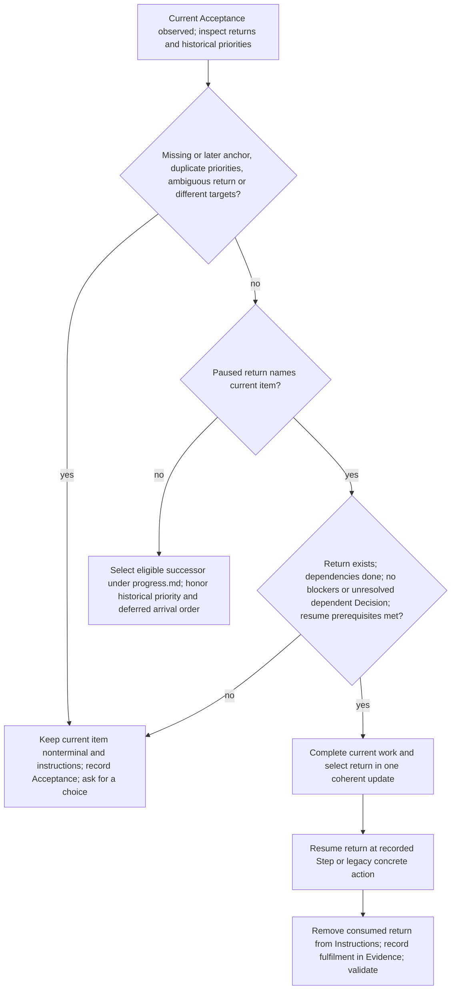

# Plan lifecycle and special cases

Use progress.md for writing and validation. Only PROJECT_INDEX.md selects the active Plan.

## Create and refine

Initialize only a wholly absent profile when a durable Plan is explicitly
requested. Prepare PROJECT_INDEX.md, docs/plans, docs/decisions and the first
Plan together. Derive title, Goal, Non-goals and the first Work Item with
Acceptance from the authorized request and binding repository context. Ask only
for missing material direction; do not invent scope, exclusions or acceptance
requirements. This initial durable-profile request selects the first Plan as
active with current_item W-001 and initial W-001 todo, without starting execution.
An explicit request for draft or idle instead leaves the Plan draft and index
idle. Write the index last. An existing partial or unsupported profile is not setup.

Use the entrypoint's ID-allocation rule. Store PLAN-0014 at
`docs/plans/0014-subject.md`; obtain a later Plan's next ID and filename with
`select_context.py --root "<project-root>" --next-id plan --format json`.
A later Plan starts draft with at least one todo item. Use this template with actual values:

```text
---
format_version: 1
id: PLAN-0014
status: draft
created: 2026-09-25
updated: 2026-09-25
---

# Plan title

## Goal

Current target and boundary; each still-binding plan-wide constraint by its effect and Decision ID.

## Non-goals

Explicit exclusions, without reasons or drafting notes.

## Work items

Insert the Work Item template from authoring.md.
```

An active Plan adds `current_item: W-001` after updated. The index uses:

```text
---
format_version: 1
active_plan: PLAN-0014
---
```

Its optional body must not duplicate live state. Use `active_plan: null` when
idle. A generic Plan edit changes only title, Goal and Non-goals, plus updated
on real changes. Preserve identity, lifecycle and Work Items.

Keep Goal to the current target, boundary and each still-binding plan-wide
constraint's effect and Decision ID. Retain the effect itself: recipients may
receive only Decisions linked to the selected item, not every ID in Goal. Keep exclusions
in Non-goals and facts in their owning fields under authoring.md and progress.md.
Omit dated steering, drafting notes, superseded constraints, copied ADR rationale
and progress history. No sentence or line quota applies.

Messages about ongoing work do not authorize Goal edits. When a Goal change is
authorized, replace superseded constraint wording with the current binding effect;
keep replacement history in its Decision. Move existing facts only with authority,
keeping them readable through the dispatched Work Item, its Decisions or a
repository contract that the agent has demonstrably loaded.

## Maintain Decisions when creating a Plan

When creating a later Plan, assess only Decisions the new Plan would link or
supersede, or whose Work Items it replaces. Read those Decisions completely;
do not scan the whole historical stock. The proposal inventory remains the
entrypoint's metadata operation, not a cleanup of every Decision.

Within this scope, remove temporary Decisions whose end or fulfilment is proved,
superseded Decisions and obsolete links under
[Decision cleanup](native-decision-format.md#scoped-decision-cleanup).
Preserve every current constraint, including a binding condition not currently
linked to a Work Item, and dependencies of other non-terminal Plans. Transfer a
still-needed effect unchanged to its readable current owner before removing
its old record; uncertain effects remain. A new Plan does not end a constraint.

This targeted maintenance needs no separate whole-project audit. Comprehensive
cleanup requires an explicit maintenance request through repair.md; ordinary
reading or continuation performs no cleanup.

## Activate

Outside the initial-profile selection above, activating a Plan requires an
explicit direction, a target draft Plan and a selected todo or paused item whose
dependencies are done. Activation does not start execution. From idle, prepare
the target Plan and index together.

When switching from an active Plan, prepare the outgoing Plan in the same
change. Use the user's chosen draft, completed or cancelled Plan status.
Apply only the user's chosen action for its current item:

- Keep a todo or paused item, or
- pause an in_progress item, or
- complete or cancel the item under progress.md.

Preserve every other item. Validate the complete resulting profile.

## Complete or cancel a Plan

When final current todo or in_progress work meets Acceptance and every other
item is terminal, prepare one coherent update:

| Owner | Terminal fields |
| --- | --- |
| Work Item | `Status: done`; retain observed Evidence; empty Blocked by; no Next action. |
| Plan | `status: completed`; no current_item. |
| Index | `active_plan: null`. |

Write the index last and validate the complete profile through progress.md.
Paused work must first resume. Create no placeholder work to avoid idle.

Cancel a draft only on explicit direction. An active Plan cannot be cancelled
or completed with a standalone status edit: reconcile current work and index
in the same prepared change.

Cancelled and completed Plans are terminal; do not reactivate them. The
wholly-unstarted exception below permits only its stated rewrite or deletion,
never a lifecycle transition.

## Rewrite or delete an unstarted Plan

An explicit rewrite or deletion may use this exception only when the whole
Plan has never executed. Activation alone is not execution. Any in_progress,
paused or done item, or actual execution evidence, defeats the exception.
Check cancelled-item Evidence; if start history is unclear, ask.

A confirmed unstarted Plan may have requested authored fields rewritten on
todo or cancelled items, even in a cancelled Plan. Preserve IDs, references,
Evidence, order and lifecycle. Cancelled items remain cancelled, with empty
blockers and no Next action. This neither reopens work nor applies to executed
history. Ordinary todo refinement uses authoring.md with progress.md permissions.

Before authorized deletion inspect incoming references and validate the complete
proposed remaining profile. Resolve invalid references without rewriting
retained history or deleting linked Decisions. If active, set the index idle
unless an eligible replacement was explicitly selected. Retain the index and
canonical directories even when no Plans remain. No cancellation record or
placeholder is required. Once execution began, retain the Plan and cancel
through the ordinary route instead of deleting it.

## Historical priority and explicit returns

Do not create new title prefixes. Read existing `Deferred after W-001:` as an
anchored deferred segment in its stored arrival order, and `Prioritized after
W-001:` as an explicitly chosen successor. Preserve that priority on recovery.
A missing or later anchor, duplicate priorities for one anchor or a conflict with
an explicit return requires a choice; never silently normalize history.

Only when the user explicitly requests return after redirect, pause the outgoing
started item and retain the binding return in Instructions:
`After W-004 completes, resume W-001 at Step N.` Keep title, Steps and position.
Read existing Next-action returns as equally binding; never silently discard them.
An ordinary pause preserves the observed Step position and remaining constraints.
Permit only one unambiguous paused return target per redirected item.

Before completing current work, inspect every paused return naming it and every
historical priority. Use paused_context and historical_priorities; read legacy
Next action and Evidence when Instructions was not captured. The helper does
not interpret these texts.



Normal selection alone never starts work; the eligible explicit return resumes
as directed. Neither route extends authorized execution scope.
