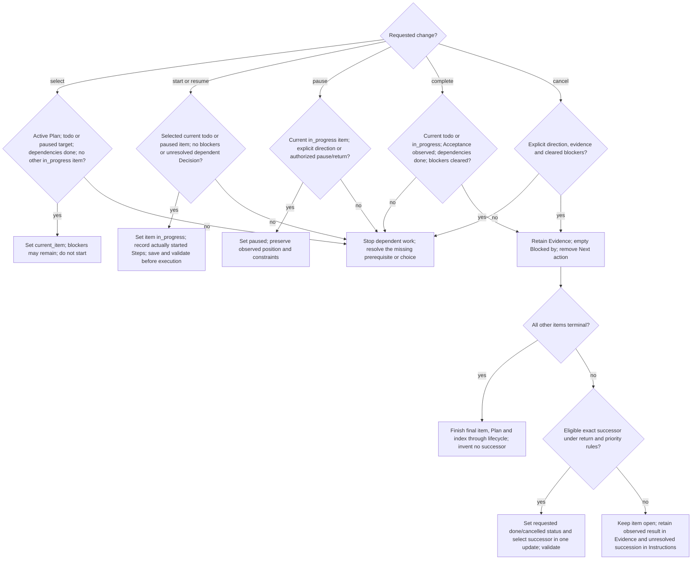

# Progress and safe record edits

## Contents

- Read and write
- Editable fields
- Step progress
- Evidence
- Instructions
- Legacy continuation
- Blockers
- Select and finish
- Structural check

## Read and write

Use the interpreter and [runtime rule](../SKILL.md#runtime-helpers) from the entrypoint.
Without suitable Python, the manual routes named there replace the commands
below.

Read PROJECT_INDEX.md, the active Plan header and the complete affected
blocks, the Decisions they reference and the relevant proposals; complete
text held from an unchanged file need not be reread. Before starting a todo
item, compare its assumptions, paths and checks with the current files and
its completed dependencies in this Plan, and refine stale instructions first.
Read a completed or cancelled Plan only for a concrete reason it is relevant.

On recovery, select the known Work Item directly and compare current_item,
item status and active Step with your assignment. Use position mode first
only when the ID is unknown, those facts disagree, or a recorded return or
priority matters. Its paused_context and historical_priorities list them;
full context contains only the selected Work Item. Settle a Step of unknown status from the evidence (the Evidence field, original reports, actual results) or the result check the authorized work needs.

```text
python -X utf8 "<skill-directory>/scripts/select_context.py" --root "<project-root>" --position --format json
python -X utf8 "<skill-directory>/scripts/select_context.py" --root "<project-root>" --format json
python -X utf8 "<skill-directory>/scripts/select_context.py" --root "<project-root>" --work-item W-001 --format json
```

Use the entrypoint's capture and diagnostic rules. Load [read-only.md](read-only.md)
only for output-field details, dispatch-unit selection or wider read tasks.

Continuation contract: keep records resumable from the files alone, with
current item and Step, remaining action, completed effects, governing
Decisions and relevant proposals, live permissions and stops, binding
Acceptance, the responsible source files, observations and their limits, and
the next permitted action. Each fact stands once in its field, without a
recovery log. For a required readable source, give its exact path and
section with a reading instruction; otherwise state the needed facts.

Edit only the record that holds the field, replacing text that occurs once in
the file. Reject redirected (symlink, junction or other reparse point) or out-of-project targets and leave
unrelated changes intact. Read and write explicitly as UTF-8, without BOM,
with LF, through a literal-safe write or patch, never as text interpolated
into a shell command.

1. Prepare the complete consistent result before writing; save related files
   together, index last.
2. Check the saved affected blocks and this edit's diff for meaning,
   permissions, current conditions and recorded Acceptance results, then
   validate. Check encoding where a warning or changed text gives a concrete
   concern.

This check covers only inspected contents. Reuse unchanged instructions
without extra copies or receipts. On a concurrent change or a partial write,
stop the dependent work until the affected records are consistent again. An
interrupted lifecycle transition needs user direction before it is completed
or undone, unless existing direction covers the same prepared, unambiguous
result with unchanged sources.

## Editable fields

| Work Item status | Permitted changes |
| --- | --- |
| todo in draft or active Plan | Authored fields, Evidence and Next action; move or delete a whole block; change state by the rules below |
| in_progress or paused | Status, Blocked by, Instructions, Evidence, legacy Next action and observed Step status; bounded amendments below |
| done or cancelled | No routine edits or state transitions; explicit cleanup under repair.md may shorten Instructions and Evidence; the exceptions below apply |

IDs never change. In a started item, keep scope, dependencies, order and
completed effects. For any status, explicit cleanup under repair.md may
shorten Outcome, Acceptance and Step wording without changing requirements,
actions or historical meaning. Explicit repair or cleanup may also clarify a
Step's established completion condition and required checks under repair.md,
without editing Outcome or Acceptance. Both exceptions need no old-text note,
copy or separate approval.

A started item permits these changes:

- Add a relevant proposed or accepted Decision. Retain older links unless
  [scoped Decision cleanup](native-decision-format.md#scoped-decision-cleanup)
  removes them under its rules.
- Correct a stale path, version reference or other purely formal wording only
  when evidence shows unchanged behavior, compatibility, data, permissions
  and verification scope, such as `docs/setup.md` renamed
  `docs/install.md`. Keep the old wording and reason in one referenced note
  or existing Git history. A changed expected result or weaker Acceptance is
  material, not formal: obtain the user's decision before dependent work and
  record it in the existing Decision system. Add a Decision link or correct formal wording in the existing Work Item, not in a replacement.
- Split the remaining work of a started Step into consecutive Steps of the
  same item without changing Outcome, Acceptance, constraints or authored
  order. Keep completed parts and their Evidence, and update Step references
  so pending assignments still identify the remaining work.
- When an authorized acceptance review finds an omitted implementation with
  no matching Step, the responsible agent may append one Step that fulfils a
  named, already binding unchanged Acceptance criterion or Work Item
  requirement. Keep existing Step text, scope, order, completed effects and
  Acceptance.
  Run the new Step through implementation, required checks and acceptance reviews. Changed
  scope, contradictory requirements or materially unclear meaning need the
  user.
- After start, an explicit user choice may replace only the execution
  annotation of a named unperformed Step, preserving its action, route and
  execution history.

Its other fields stay fixed, apart from the repair.md exceptions above. Resume paused work to in_progress, never todo.
The Plan lifecycle reference has the explicit wholly-unstarted exception.

## Step progress

A Step without written status is legacy unknown, which is neither todo nor
done. Written status comes first:
todo, in_progress, done or cancelled. Preserve explicit route and execution
annotations; load [authoring.md](authoring.md#step-annotations) when authoring
or changing them. Annotation syntax proves no model availability or support.

During ordinary work, add or update status only from observed progress. Begin
in_progress when work starts, not on selection alone. Mark done when the
Step's action and required checks are complete. Cancelled needs explicit
direction and is never done. In a nonterminal item, a confirmed correction
may return a done Step to in_progress; retain its completed effects and
reason in Evidence. A status change does not rewrite the action, order, route
or execution choice. Pause and blockers remain on the Work Item. Update
observed Step status at start, completion, interruption and correction, and
before handoff or compaction. Reviews and Acceptance due on the Work Item
stay due: all Steps done neither completes the Work Item nor authorizes
repeating them.

## Evidence

Record observed results, that a required review took place, confirmed open
defects and the limits needed to establish accepted work and the next
permitted action. For an effect that cannot be repeated, keep what it was and
how it ended; do not repeat an accepted effect to recreate its evidence. Name
the kind of check: source review, structural check, behavioral test, runtime
or publication. Keep facts that further development or a retention rule
needs, not review transcripts or run chronology.

The field is normally sufficient. Link existing reports for needed detail;
create or update one only when the task requires that detail, not to fit the
field limit. Create no archive, copy, hash or inventory to document checks,
reviews or cleanup. Keep progression in its Plan fields.

Prefer one-line plain text, for example:
`Evidence: Unicode cases passed; independent review performed; open: installer ordering, Step 3.`
Keep it within the supported 200 characters. Commas and brackets within the text
are allowed; do not start plain text with `[`. Use `[]` when nothing was observed.
Preserve supported existing lists.

## Instructions

Instructions holds the additional conditions binding the item now: stops,
limits, explicit returns or required overall reviews. Actions go in Steps,
observations in Evidence, status in its field; repeat no Outcome, Acceptance
or history.

Use one short line or exactly []; a missing field is legacy unknown, not [].
New items write it explicitly. When conditions change, replace the whole
field with the remaining conditions in current words, dropping fulfilled or
superseded ones, so that old and new text cannot contradict each other. Keep
an unclear live condition briefly and ask only if the next action depends on
its meaning. Before setting an item done or cancelled, confirm that it
holds no unmet condition. Instructions of a terminal item are history, not
live direction.

## Legacy continuation

A legacy Next action can hold binding conditions too: read it for them and
keep a return it grants. A nonterminal legacy item without written Step
status still needs its nonempty Next action; while retained, keep it
consistent with observed progress. New work uses Steps instead.

## Blockers

Blocked by is `[]` or a comma-space-separated list such as `[EXT-API-KEY]`.
Labels match `[A-Z][A-Z0-9]{1,15}-[A-Z0-9][A-Z0-9._-]{0,47}`; prefixes
`ADR`, `PLAN` and `W` are reserved. Each label is unique and names an actual
external prerequisite; one invented to satisfy validation would block real work.
Remove a named blocker only with proof; keep unresolved prerequisites and
their effect in Evidence.

## Select and finish

An explicit request to execute the whole Plan authorizes continuing item by
item within that scope, without asking again after each. An older stop
applies only to its recorded scope. A newer explicit direction replaces
an older instruction only where they conflict; it satisfies no dependency,
Acceptance or substantive cost, safety or external prerequisite. Ask only if
a material conflict remains.



Resume paused work before completing it. Cancelled work satisfies no
dependency of unfinished work; a done or cancelled item may keep such a link
as history. Reopening a terminal item needs the explicit lifecycle direction
that repair.md describes. Selecting an ordinary successor, which may still be blocked, does not authorize executing it. Start it only after its pre-start checks (the comparison under Read and write and the start conditions in the flowchart) and within the authorized scope. An explicit return instead
follows the lifecycle's stricter resume prerequisites. Unresolved succession
is no reason to repeat completed work.

Read structural facts with `select_context.py --root "<project-root>"
--check-start W-NNN --format json`; add --plan PLAN-NNNN to inspect a named
Plan, including a draft or inactive one. The output distinguishes todo, paused
resume, already started and terminal work, checks current_item and lists
dependencies, blockers, other started items and linked open proposals. A
successful read and an empty violated_conditions list grant no permission or
acceptance. Judge proposal relevance and whether the action is actually permitted
yourself; the helper neither chooses a successor nor writes a start.

Inspection ranges and read-only reviews start no Step. These field edits need
no separate operation or progress record.

Before selecting a successor, inspect the records for recorded returns and
explicit historical priority. Both come before default document order; if
they conflict, ask for a choice. Keep an ambiguous, missing, blocked or
dependency-invalid return and ask; do not skip it. For historical prefixes
or an immediate redirect read the special cases in the Plan lifecycle
reference.

## Structural check

Use the entrypoint's [helper invocation pattern](../SKILL.md#helper-invocations):

```text
python -X utf8 "<skill-directory>/scripts/validate_profile.py" --root "<project-root>" --format json
```

Read warning diagnostics too: FILE_MOJIBAKE_SUSPECTED gives file, line and
column for common misdecoding sequences in prose. Warnings alone retain
valid=true and exit 0. Fenced/inline code is excluded; unquoted encoding examples
may warn. The heuristic misses other damage. Compare suspicious text with its
intended wording and correct confirmed damage by hand within the editing
rights above, never automatically: an automatic repair would also rewrite
intentional examples.

Invoke helpers without loading their Python source. They inspect structure and
references, not permission, meaning or whether Acceptance is met. No planning
CLI writes records. Read both exit code and JSON valid:

| Exit / valid | Action |
| --- | --- |
| 0 / true | Structural check passed for these bytes; assess semantics separately |
| 1 / false | Follow ordered file and field diagnostics; repair only unambiguous representation defects and rerun |
| 2 / null | Inspection incomplete (path, access or I/O); resolve the condition, claim no pass |
| 3 / null | Helper failure; report it and leave structural acceptance open |

Validation is not a snapshot or a general before/after change detector. The
Selector can report FILE_CHANGED_DURING_READ when an opened file is no longer
regular; this does not detect all concurrent edits.

Under the [Runtime helpers rule](../SKILL.md#runtime-helpers), a failed helper leaves the structural check open; a manual pass never replaces it. Report a remaining lifecycle or scope choice
instead of inventing state to satisfy a diagnostic.
