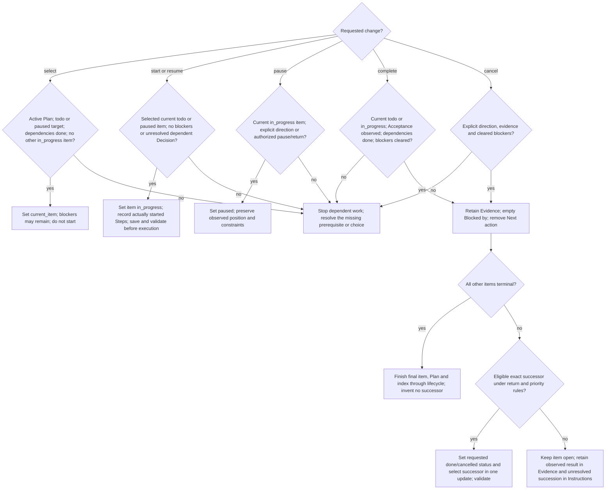

# Progress and safe record edits

## Read and write

Use the interpreter and [runtime rule](../SKILL.md#runtime-helpers) from the entrypoint.
Without suitable Python, use the manual routes named there;
do not invoke these commands.

Read PROJECT_INDEX.md, the active Plan header and the complete affected blocks.
Read referenced Decisions and relevant proposals. Before starting a todo item,
check its premises, paths and checks against current sources and relevant
completed dependencies in this Plan. Refine stale instructions before start.
Do not scan historical Plans without a concrete relevance reason.

On recovery, select the recorded Work Item directly when its ID is known;
check the Plan's current_item, the item's status and its block against the
expected in_progress Work Item and active Step. Use position mode first when
the ID is unknown, any of these disagree, or return directions from
paused_context or historical_priorities matter. All helper
calls use the entrypoint's [capture pattern](../SKILL.md#helper-invocations).
Its key fields are `plan`, `plan_status`, `work_item`, `work_status`,
`current_steps`, `current_units`, `next_step`, `instructions`, `paused_context`
and `historical_priorities`; [read-only.md](read-only.md) explains further fields.
Do not reconstruct the position or load repair.md for ordinary recovery. Unknown
Steps require only the evidence or result check needed for the authorized work.
Use paused_context and historical_priorities to check relevant return directions;
the full-context mode contains only the selected Work Item.

```text
python -X utf8 "<skill-directory>/scripts/select_context.py" --root "<project-root>" --position --format json
python -X utf8 "<skill-directory>/scripts/select_context.py" --root "<project-root>" --format json
python -X utf8 "<skill-directory>/scripts/select_context.py" --root "<project-root>" --work-item W-001 --format json
```

Apply the entrypoint's diagnostic and capture rules. Load read-only.md only
for further output-field details, dispatch-unit selection or wider read tasks.

Edit only owning records with uniquely anchored replacements. Reject redirected
or out-of-project targets; preserve unrelated changes. Follow shared literal-safe
writing and shell rules. Read and write explicitly as UTF-8, without BOM, with LF.

1. Prepare the complete consistent result before opening targets. Python replacement
   writes use LF-normalized UTF-8 bytes; a text writer's newline is an actual LF,
   never literal backslash and n. Use the shared rule before piping into Python.
2. Write prepared files, index last for multi-file updates. Decode saved UTF-8 bytes
   and compare changed non-ASCII text with its intended wording.
3. Reread complete affected blocks and the scoped diff; assess meaning, authority,
   current constraints and Acceptance evidence, then validate. Keep actions in Steps,
   observations in Evidence and extra live conditions in Instructions. Remove finished
   actions and history from Instructions; retain safeguards and due reviews.

This covers only inspected contents. Reuse unchanged instructions without extra
copies or receipts. Stop dependent work on concurrent changes or a partial write.
An interrupted lifecycle transition needs user direction before completion or undo;
existing direction suffices only for the same prepared, unambiguous result with
unchanged sources. Otherwise ask.

## Editable fields

| Work Item status | Permitted changes |
| --- | --- |
| todo in draft or active Plan | Authored fields, Evidence and Next action; move or delete a whole block; change state by the rules below |
| in_progress or paused | Status, Blocked by, Instructions, Evidence, legacy Next action and observed Step status; bounded amendments below |
| done or cancelled | No routine edits or state transitions; explicit cleanup under repair.md may shorten Instructions and Evidence; the exceptions below apply |

IDs never change. Preserve started scope, dependencies, order and completed effects.
For any status, explicit cleanup under repair.md may shorten Outcome, Acceptance
and Step wording without changing requirements, actions or historical meaning.
Explicit repair or cleanup may also clarify a Step's established completion
condition and required checks under repair.md. This Step clarification permits
no Outcome or Acceptance edits. Both exceptions need no old-text note, copy
or separate approval.

A started item may add a relevant proposed or accepted Decision. Retain older
links unless explicit cleanup removes them under repair.md's relevance check.
It may correct a stale path, version reference or other purely formal wording only when evidence shows unchanged behavior, compatibility,
data, authority and verification scope. Retain the old wording and reason in
one referenced note or existing Git history. A changed expected result or weaker
Acceptance is material, not a formal correction; obtain the user's decision
before dependent work and record it in the existing Decision system. Do not
create a replacement Work Item merely to add a Decision or fix formal wording.

Remaining work in a started Step may be split into consecutive Steps
in the same Work Item without changing its Outcome, Acceptance, constraints or
authored order. Preserve completed parts and their Evidence, and update affected
Step references so pending assignments still identify the remaining work.
Other started fields remain fixed except for these explicit repair.md exceptions. Resume paused work to in_progress, never
todo. The Plan lifecycle reference owns the explicit wholly-unstarted exception.
When an authorized Workflow closure review finds an omitted implementation
with no existing matching Step, the main thread may append one Step that fulfils
a named, already binding unchanged Acceptance criterion or Work Item requirement.
Preserve existing Step text, scope, order, completed effects and Acceptance.
Run the new Step through execution, required Step review and closure review. Changed
scope, contradictory requirements or materially unclear meaning need the user.
An explicit user choice may replace only the execution annotation of a named
unperformed Step after start, preserving its action, route and execution history.

## Step progress

A Step without written status is legacy unknown, never assumed todo or done.
Status comes first, as in `1. [status: todo] <action>`. This shows annotation
syntax only; authoring.md governs sufficient Step content. It is todo,
in_progress, done or cancelled. Preserve explicit route and
execution annotations; changing or authoring them loads
[authoring.md](authoring.md#step-annotations). These formats prove no model availability.

During ordinary work, add or update status only from observed progress. Begin
in_progress when work starts, not on selection alone. Scoville Workflow starts
exactly one Step at a time. Mark done when the
Step's action and required checks are complete. Preserve due Work Item reviews
and acceptance. Cancelled needs explicit direction and is never done.
In a nonterminal item, a confirmed correction may return a done Step to
in_progress; retain its completed effects and reason in Evidence. Status changes
do not rewrite the action, order, route or execution choice. Pause and blockers
remain on the Work Item. Update observed Step status at start, completion,
interruption and correction, and before handoff or compaction.
All Steps done does not itself complete the Work Item or authorize repeating them.

## Evidence

Record the observed result briefly. For a required review, record that it took
place. Keep confirmed open defects as current work, not as a review transcript.
Keep facts and existing evidence references needed to establish accepted work,
remaining defects and the next permitted action, including the identity and
outcome of effects that must not be repeated. Distinguish source review,
structural checks, behavioral tests and runtime or publication evidence.
Do not repeat an accepted effect merely to recreate evidence.
Do not copy or archive reviews or a run chronology. Review texts serve only the
development process; full execution results serve the running assessment and
correction. Keep only facts needed for further development or an independently
binding retention requirement.

The field is normally sufficient. Link an existing report only for needed detail;
create or update a separate report only when the task requires that detail.
Do not create archives, copies, hashes or inventories merely to document checks,
reviews or cleanup. Progress and next actions belong in their Plan fields.

Prefer one-line plain text, for example:
`Evidence: Unicode cases passed; Sol high review performed; open: installer ordering, Step 3.`
Keep it within the supported 200 characters. Commas and brackets within the text
are allowed; do not start plain text with `[`. Use `[]` when nothing was observed.
Preserve existing supported lists without routine migration. Explicit cleanup
uses repair.md; it needs no copy of the old Evidence or new report. New writes retain LF.

## Instructions

Use Instructions only for current binding conditions applying to the Work Item
that are not already stated in its Steps, such as a user stop or limit, an
explicit return or a required overall review. Do not repeat or paraphrase Steps,
Outcome or Acceptance, or put status summaries, results, review text, versions,
counts or history here. Ordinary actions remain in Steps; results belong in Evidence.

Use one short line or exactly []; absence is legacy unknown, not []. New items
write it explicitly. When conditions change, replace the whole field with the
remaining conditions in current words. Drop fulfilled or superseded conditions;
do not prepend new text to old instructions. Keep an unclear live condition
briefly and ask only if the next action depends on its meaning. Before new
terminal closure no unmet binding condition remains. Do not reinterpret terminal
history as live instructions. Explicit cleanup of old fields uses repair.md.

## Legacy continuation

Read legacy Next action for binding conditions too; preserve existing return
authority. Legacy nonterminal work without written Step status still needs its nonempty
Next action. When retained during legacy work, keep it consistent with observed
progress. New work uses Steps instead.

## Blockers

Blocked by is `[]` or a comma-space-separated list such as `[EXT-API-KEY]`.
Labels match `[A-Z][A-Z0-9]{1,15}-[A-Z0-9][A-Z0-9._-]{0,47}`; prefixes
`ADR`, `PLAN` and `W` are reserved. Use unique labels for actual external
prerequisites, never invent one to satisfy validation. Resolve only a named
blocker with proof; retain unresolved prerequisites and their effect in Evidence.

## Select and finish

An explicit request to execute the whole Plan authorizes ordinary continuation
within that scope; do not ask again after each item. Read older stops in their
recorded scope. A newer explicit direction replaces an older instruction only
where they conflict; it does not satisfy dependencies, Acceptance or substantive
cost, safety or external prerequisites. Ask only if a material conflict remains.



Resume paused work before completion. Cancelled work satisfies no dependency.
No terminal state may be routinely reopened. Start a selected successor only after
its pre-flight and within authorized scope; selection alone grants no execution.
An ordinary successor may be blocked and selected without starting. An explicit
return instead follows the lifecycle's stricter resume prerequisites. Completed
work must not be repeated merely because succession remains unresolved.

Read structural facts with `select_context.py --root "<project-root>"
--check-start W-NNN --format json`; add --plan PLAN-NNNN to inspect a named
Plan, including a draft or inactive one. The output distinguishes todo, paused
resume, already started and terminal work, checks current_item and lists
dependencies, blockers, other started items and linked open proposals. A
successful read and an empty violated_conditions list grant no permission or
acceptance. Determine proposal relevance and actual authority yourself;
the helper neither chooses a successor nor writes a start.

Selecting current_item or an inspection range starts no Step. Read-only review
does not restart completed Steps. These field edits need no separate named
operation or extra progress record.

Honor recorded returns and explicit historical priority before default document
order; if those obligations conflict, ask for a choice. Inspect the records
before selection. On an
ambiguous, missing, blocked or dependency-invalid return, retain it and ask
rather than skip it. For historical prefixes or an immediate redirect read the
special cases in the Plan lifecycle reference.

## Structural check

Use the entrypoint's [helper invocation pattern](../SKILL.md#helper-invocations):

```text
python -X utf8 "<skill-directory>/scripts/validate_profile.py" --root "<project-root>" --format json
```

Read warning diagnostics too: FILE_MOJIBAKE_SUSPECTED gives file, line and
column for common misdecoding sequences in prose. Warnings alone retain
valid=true and exit 0. Fenced/inline code is excluded; an unquoted literal
encoding example may warn. This heuristic misses other damage. Compare changed
non-ASCII text manually with intended wording and never repair it automatically.

Invoke helpers without loading their Python source. They inspect structure and
references, not authorization, meaning or acceptance truth. No planning CLI is
a write path. Read both exit code and JSON valid:

| Exit / valid | Action |
| --- | --- |
| 0 / true | Structural check passed for these bytes; assess semantics separately |
| 1 / false | Follow ordered file and field diagnostics; repair only unambiguous representation defects and rerun |
| 2 / null | Inspection incomplete (path, access, I/O or concurrent change); resolve the condition, claim no pass |
| 3 / null | Helper failure; report it and leave structural acceptance open |

Follow the [Runtime helpers rule](../SKILL.md#runtime-helpers). Never
turn a helper error into a manual pass. Report a remaining lifecycle or scope
choice instead of inventing state to satisfy a diagnostic.
